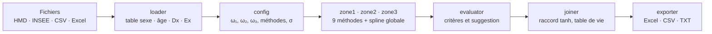

# Mortality Table Smoother

> Lissage paramétrique de tables de mortalité brutes par zone d'âge, avec interface Streamlit.
> Toute la mécanique d'estimation est écrite **from scratch** : aucun package actuariel.


---

## Ce que fait l'outil

1. **Charge** des taux de mortalité bruts (ou des décès et une exposition) depuis un fichier HMD, INSEE, Eurostat, CSV ou Excel, et contrôle leur qualité.
2. **Ajuste** neuf méthodes de lissage réparties en trois zones d'âge, séparément pour chaque sexe, plus, en option, une **spline unique sur tous les âges**.
3. **Évalue** chaque méthode (AIC, BIC, χ², déviance, runs test, résidus, Whittaker-Henderson) et suggère la meilleure de chaque zone.
4. **Raccorde** les zones choisies en une courbe `μₓ` continue sur `[0, ω₃]`, en déduit la table de vie, puis l'**exporte** (Excel, CSV, texte au format HMD).



---

## Démarrage rapide

Python 3.11 ou plus récent.

```bash
git clone https://gitlab.com/<namespace>/mortality-table-smoother.git
cd mortality-table-smoother
pip install -r requirements.txt
python -m streamlit run app.py
```

> `python -m streamlit run app.py` fonctionne même quand le dossier `Scripts` de Python n'est pas dans le `PATH`
> (cas de Python installé depuis le Microsoft Store sous Windows). Lancez la commande **depuis la racine du projet**.

**Premier essai en trois minutes** avec le fichier fourni `sample_data/FRA_taux_bruts_moment_2020_female_male.csv`
(France 2020, féminin et masculin, issu de la Human Mortality Database) :

1. **Accueil** : cliquez sur « Lisser des tables du moment ».
2. Page **Chargement** : choisissez « C — Un fichier de données élémentaires », déposez le fichier, cliquez sur **Charger**.
3. Page **Paramétrage** : gardez les valeurs par défaut (ω₁ = 20, ω₂ = 85, ω₃ = 110, σ = 3), cliquez sur **Lancer les estimations**.
4. Page **Évaluation** : lisez le tableau des critères, ajustez si besoin les trois menus « Méthode finale », cliquez sur **Valider la sélection**.
5. Page **Export** : consultez le graphique final et téléchargez la table.

Le thème Risk Data Lab est dans `.streamlit/config.toml`, que Streamlit lit dans le dossier où l'on lance `streamlit run` : lancez bien la commande depuis la racine du projet.

Le dossier `sample_data/` contient aussi des fichiers synthétiques, un par disposition de fichiers acceptée.

---

## Interface : un accueil et quatre pages

L'**accueil** demande quelles tables lisser : **du moment** (une année civile) ou **générationnelles** (une génération), cette seconde
voie étant une extension qui réutilise la même chaîne de lissage. Le choix ouvre la page Chargement et reste rappelé en haut de la barre latérale ; un autre choix
à l'accueil abandonne les données déjà chargées, qui ne correspondraient plus. La barre latérale marine, présente sur toutes les pages y compris l'accueil, donne les liens des quatre pages, avec une coche ✓ sur celles
déjà faites, et un lien vers l'accueil. Chaque page se souvient de ses choix (sexe affiché, cases « Lier », h, disposition des fichiers) quand on la quitte et qu'on y revient.

| # | Page | Ce qu'on y fait |
|---|--------|-----------------|
| 1 | **Chargement** | Dépôt des fichiers, choix de la disposition, de l'année (ou de la génération) et du sexe, contrôles qualité détaillés, taux bruts `log(mₓ)`. |
| 2 | **Paramétrage** | Frontières ω₁ et ω₂ (ω₂ part toujours de ω₁ + 1), méthodes à tester dans chaque zone, spline sur tous les âges, σ de jonction, options avancées. **Chaque sexe a sa propre configuration**, ou la même si l'on coche « Lier le féminin et le masculin ». |
| 3 | **Évaluation** | Tableau triable de tous les critères, résidus de déviance et taux bruts contre lissés (deux graphiques pleine largeur, légende à droite), menu « Méthode finale » par zone, bouton « Valider la sélection ». La case « Lier » reporte sur l'autre sexe la méthode choisie dans chaque zone. |
| 4 | **Export** | Courbe finale colorée par zone, aperçu de la table (50 premières et 50 dernières lignes), trois téléchargements. Les options d'export (colonnes, séparateur, marque décimale, multi-méthodes) sont propres à chaque sexe, ou communes si l'on coche « Lier ». |

**Lier les deux sexes.** Une case par page (Paramétrage, Évaluation et Export), indépendantes. Cochée, ce qui est réglé pour le sexe affiché est copié tout de suite sur
l'autre, puis chaque réglage fait sur l'un est reporté sur l'autre. Pour copier le féminin vers le masculin, cochez la case alors que le féminin est
affiché. Décochée, les deux sexes redeviennent indépendants et gardent ce qu'ils ont. Si les deux tables n'ont pas les mêmes âges, les frontières copiées
sont ramenées dans la plage de l'autre sexe ; sur la page Évaluation, une méthode que l'autre sexe n'a pas estimée n'est pas reportée (la page le dit).

**Charte graphique.** L'application suit celle de Risk Data Lab : marine `#134A7C`, bleu `#1B6CA8`, vert `#3EB553`. Les illustrations (le logo, la courbe de
mortalité en trois zones, les pictogrammes des cartes et des quatre étapes) sont dessinées en SVG par le code : le dépôt ne contient aucun fichier image. La courbe est celle de la France 2020
(HMD, deux sexes) : les taux bruts en points et une loi lissée qui en reproduit la chute infantile, le minimum de l'enfance et la bosse des jeunes. Elle utilise les tons clairs du logo ;
les graphiques de données gardent leurs couleurs de zones, choisies pour rester distinctes en cas de daltonisme.

---

## Méthodes par zone

| Zone | Âges | Méthode | Modèle | Estimation |
|------|------|---------|--------|------------|
| **I** | 0 – ω₁ | Polynôme degré 3 | `ln μₓ = a₀ + a₁x + a₂x² + a₃x³` | WLS en forme fermée, poids `Dₓ` : `â = (AᵀWA)⁻¹AᵀWy` |
| | | Spline cubique naturelle | `ln μₓ` spline, un nœud tous les 5 âges | WLS sur la base de splines (`CubicSpline`) |
| **II** | ω₁ – ω₂ | Gompertz | `μₓ = exp(α + βx)` | MLE Poisson, Newton-Raphson 2×2 |
| | | Makeham | `μₓ = A + B·cˣ` | Profil sur `c` (grille de 100 valeurs dans [1,05 ; 1,15], puis affinage) et Newton 2×2 sur `(A, B)` avec `A ≥ 0` |
| | | Makeham 2ᵉ ordre | `μₓ = A + B·cˣ + D·dˣ` | MLE Poisson, Nelder-Mead depuis Makeham |
| | | Perks | `μₓ = (A + B·cˣ) / (1 + D·cˣ)` | MLE Poisson, Nelder-Mead depuis Makeham |
| **III** | ω₂ – ω₃ | Kannisto | `μₓ = a·eᵇᵗ / (1 + a·eᵇᵗ)`, `t = x − ω₂` | Grille 2D sur `(ln a, b)`, puis Newton-Raphson 2×2 |
| | | Beard | `μₓ = B·cˣ / (1 + K·B·cˣ)` | MLE Poisson, Nelder-Mead depuis Kannisto |
| | | Coale-Kisker | `qₓ = q_ω₂ · exp(k·(x − ω₂))`, `q(ω₃) = 0,6` | Formule directe, sans estimation |
| **Toutes** | 0 – ω₃ | Spline globale (option, décochée par défaut) | Même spline naturelle, un nœud tous les 5 âges, sur tous les âges | Même WLS que la zone I, mais sur tout `[0, ω₃]` |

**Spline sur tous les âges.** Cochée sur la page Paramétrage, elle est ajustée **une seule fois** sur toute la table, quelles que soient ω₁ et ω₂, puis proposée
comme méthode dans le menu de **chacune des trois zones** (page Évaluation). Elle y est évaluée zone par zone, avec les mêmes critères que les autres méthodes :
une ligne par zone dans le tableau, lue sur les âges de la zone. Son AIC et son BIC ne comptent que les nœuds situés dans la zone (bornes comprises, au moins un),
pas les 23 de la spline entière. Choisie dans les trois zones, la table finale est cette courbe seule (les poids du raccord somment à 1). Choisie dans une
seule, elle est raccordée à la zone voisine comme n'importe quelle autre méthode. Sur France 2020 féminin, elle l'emporte à l'AIC en zones II et III
(avec des expositions nationales, une courbe souple bat les lois paramétriques) : la suggestion de la page Évaluation s'y porte donc dès qu'elle est cochée.

**Jonction.** Les zones sont raccordées par une pondération en tangente hyperbolique,
`w(x) = (1 + tanh((ωᵢ − x)/σ)) / 2`, sur la fenêtre `[ωᵢ − 2σ, ωᵢ + 2σ]` autour de chaque frontière.
Sur trois zones, les poids sont `w₁`, `(1 − w₁)·w₂` et `(1 − w₁)(1 − w₂)` : leur somme vaut 1 à tout âge, même si les fenêtres se chevauchent.

**Table de vie.** `qₓ = 1 − exp(−μₓ)`, `lₓ` de racine 100 000, `dₓ = lₓ·qₓ`, espérance de vie complète `eₓ`.
La table n'est pas refermée à `q = 1` à ω₃ ; les survivants au-delà y vivent à force de mortalité constante.

---

## Évaluation et sélection

Pour chaque méthode, sur les âges de données de sa zone :

| Critère | Définition |
|---------|-----------|
| χ² de Pearson | `Σ (Dₓ − Êₓ)² / Êₓ`, avec `Êₓ = Eₓ·μ̂ₓ`, comparé à `χ²(n − p)` |
| Déviance | `2 Σ [Dₓ ln(Dₓ/Êₓ) − (Dₓ − Êₓ)]` |
| AIC, BIC | `−2ℓ + 2p`, `−2ℓ + p·ln n` : à comparer **au sein d'une même zone** (colonne ΔAIC) |
| Runs test | Séries de résidus de déviance de même signe (Wald-Wolfowitz) |
| Résidus de déviance | `signe(Dₓ − Êₓ)·√dₓ`, part des valeurs hors de ±2 |
| Whittaker-Henderson | `Σ wₓ(qₓ − zₓ)² + h·Σ (Δ²zₓ)²`, fidélité et rugosité aussi données séparément |

**Règle suggérée.** Dans chaque zone : l'AIC le plus bas parmi les méthodes dont le runs test n'est pas significatif (p > 0,05) ;
à défaut, l'AIC le plus bas. Les menus de la page Évaluation sont préremplis avec cette suggestion, vous restez libre d'en changer.

---

## Données d'entrée

L'outil **importe** des taux déjà calculés (ou les décès et l'exposition qui les donnent) ; il n'estime rien au chargement.
Trois dispositions de fichiers, au choix :

| Option | Disposition | Exemple |
|--------|-------------|---------|
| **C** (recommandée) | Un seul fichier de données élémentaires : âge, sexe, année, décès, exposition | Export de base de données, INSEE `T74BIS`, Eurostat, fichier standard produit par l'outil |
| **A** | Un fichier de taux (ou de décès) et un fichier d'exposition, sexes en colonnes | HMD `Mx_1x1` + `Exposures_1x1`, ou `Deaths_1x1` + `Exposures_1x1` |
| **B** | Un fichier par sexe | `femmes.csv`, `hommes.csv` |

- **Tables du moment** (une année) **ou générationnelles** (une cohorte), pour les deux sexes ou un seul.
- **Formats** : texte HMD, CSV (séparateur `,` `;` ou tabulation), TSV Eurostat, Excel `.xlsx` (feuille et ligne d'entête configurables). Colonnes reconnues automatiquement, correspondance manuelle possible.
- **Âges avec `Dx = 0`** : conservés, ils entrent dans la vraisemblance. Le groupe d'âges ouvert (`110+`) est traité explicitement.
- **Refusé avec un message explicite** : les fichiers HMD *InputDB* (triangles de Lexis), qui ne sont ni des taux ni des décès par âge, et les données par tranches d'âge.

Dispositions éprouvées sur fichiers réels : HMD (taux et expositions) et INSEE `T74BIS`. Eurostat est modélisé d'après sa documentation,
les populations INSEE `POP3` et CDC WONDER n'ont pas été vérifiées sur fichier réel.

---

## Export

| Format | Contenu |
|--------|---------|
| **Excel** `.xlsx` | `Table_lissée` (age, mu, qx, px, lx, dx, ex) · `Taux_bruts` (age, Dx, Ex, mx_raw) · `Paramètres` (paramètres estimés par zone et méthode, méthode retenue marquée) · `Critères` · `Graphique`. Option : une feuille `Méthode_<clé>` par méthode testée. |
| **CSV** | Les colonnes choisies, séparateur `,` ou `;`, marque décimale `.` ou `,`. |
| **TXT** | Mise en page HMD : titre, ligne vide, entête, colonnes alignées séparées par des espaces. |

Les téléchargements sont construits au clic : modifier un réglage ailleurs ne recalcule pas le fichier Excel.

---

## Choix méthodologiques notables

- **Vraisemblance de Poisson partout**, y compris en zone III, où le cahier des charges évoque une loi binomiale. Aux plus grands âges, `Dx` dépasse `Ex` (France 2020 : 105 ans pour les deux sexes, taux jusqu'à 2,0) : une binomiale n'y a plus de vraisemblance.
- **La zone III couvre toujours ω₂ à ω₃**, même si la table s'arrête avant (HMD s'arrête à 109 ans, ω₃ vaut 110 par défaut) : c'est précisément l'extrapolation que cette zone fournit.
- **Âge compté depuis ω₂ pour Kannisto** : le paramètre `a` est alors la cote de mortalité à ω₂ (de l'ordre de 0,06 à 0,10), dans la grille `[0,001 ; 1]` du cahier des charges.
- **Nelder-Mead pour les modèles à plusieurs exponentielles**, avec départ Makeham ou Kannisto, coordonnées recentrées et redémarrages. Un paramètre dont la valeur optimale est 0 est ramené exactement à 0 lorsque le modèle contraint est aussi bon que le libre (Perks se réduit ainsi à Makeham sur France 2020).
- **Sexes traités séparément** : configuration, estimation, évaluation, sélection et table de vie sont propres à chaque sexe.
- **Bords de fenêtre continus** : la pondération tanh est étalée pour valoir exactement 1 et 0 aux bords de la fenêtre. Le constant `CONTINUOUS_EDGES` de `src/joiner.py` rétablit la formule littérale.

---

## Limites connues

- **Zone I.** Un polynôme de degré 3, ou une spline à un nœud tous les 5 âges, ne suit pas la chute entre 0 et 1 an : sur France 2020, l'âge 1 est surestimé de 4 à 6 fois et les âges 2 et 3 de 1,3 à 2 fois, la forme générale (chute, minimum vers 6-8 ans, remontée) restant correcte.
- **Coale-Kisker.** La cible conventionnelle `q(ω₃) = 0,6` est très inférieure à ce que montrent les données de France 2020 (`q` observé déjà de 0,63 à 0,86 à 109 ans) : la méthode s'ajuste très mal à ces tables. L'argument `q_target` de `fit_coale_kisker` permet de l'explorer.
- **Coale-Kisker, ancrage.** La courbe s'appuie sur le taux brut d'un seul âge (ω₂) : bruité pour une petite population.
- **Tests du χ².** Avec des expositions nationales, les p-values sont proches de 0 pour toutes les lois paramétriques : lisez-les avec l'AIC, les résidus et le runs test.
- **Données par âge simple uniquement** (pas de tranches d'âge).

---

## Structure du projet

```
mortality-table-smoother/
├── app.py                    # Point d'entrée Streamlit : thème, navigation, barre latérale
├── views/                    # Les pages : accueil, chargement, paramétrage, évaluation, export
├── ui/                       # Briques communes aux pages : constantes, état de session, aides, thème Risk Data Lab
├── .streamlit/config.toml    # Thème Risk Data Lab
├── src/
│   ├── loader/               # Chargement, parsing, contrôles qualité (paquet)
│   ├── config.py             # SmootherConfig, registre des méthodes, FitResult, zones
│   ├── fit_common.py         # Contrôle des entrées, log-vraisemblance de Poisson, Nelder-Mead
│   ├── zone1_poly.py         # Polynôme degré 3 et spline naturelle
│   ├── zone2_gompertz.py     # Gompertz
│   ├── zone2_makeham.py      # Makeham
│   ├── zone2_makeham2.py     # Makeham 2ᵉ ordre
│   ├── zone2_perks.py        # Perks
│   ├── zone3.py              # Kannisto, Beard, Coale-Kisker
│   ├── spline_all.py         # Spline naturelle sur tous les âges (méthode globale)
│   ├── joiner.py             # Raccord tanh, conversion μ → q, table de vie
│   ├── evaluator.py          # Critères et suggestion de sélection
│   └── exporter.py           # Excel, CSV, texte HMD, graphique
├── tests/                    # Suite pytest (données synthétiques et réelles)
├── notebooks/
│   └── 01_loader_demo.ipynb  # Démonstration du chargement
├── sample_data/              # Un fichier d'exemple par disposition acceptée
├── requirements.txt          # Dépendances d'exécution
├── requirements-dev.txt      # + pytest
├── LICENSE                   # MIT
└── pytest.ini
```

Chaque méthode `k` est exposée par une fonction `fit_<k>(ages, Dx, Ex, cfg)` qui retourne un `FitResult`
(`method`, `zone`, `ages`, `mu_hat`, `params`, `loglik`, `converged`, `n_iter`, `message`).
Les méthodes d'une zone sont inscrites dans `config.METHODS`. Une méthode **globale** (la spline sur tous les âges) l'est dans `config.GLOBAL_METHODS`,
avec `zone = "all"` ; `config.zone_view` la présente à chaque zone avec sa part de paramètres.
Les modules de zone s'appuient sur `config` et `fit_common` (Perks et Makeham 2ᵉ ordre partent en plus de l'ajustement Makeham). Ajouter une méthode
demande d'écrire sa fonction `fit_<clé>`, de l'inscrire dans `config.METHODS` et d'ajouter sa formule à `joiner.evaluate_curve`, qui relit chaque
courbe à partir de ses paramètres pour le raccord et les évaluations.

---

## Tests

```bash
pip install -r requirements-dev.txt
python -m pytest tests
```

Plus de 700 tests : formules comparées à des oracles indépendants (SciPy, énumération exhaustive, boucles naïves), récupération
exacte de lois connues à partir de comptages sans bruit, propriétés d'optimalité (équations de score, optimum global par évolution
différentielle), parcours de l'application avec `streamlit.testing`, et chaîne complète sur la France 2020 de la HMD.
Les tests sur fichiers HMD réels sont ignorés si les fichiers sont absents (dossier indiqué par la variable d'environnement `MORTALITY_POST3_DIR`).

---

## Dépendances

`numpy` · `scipy` · `pandas` · `openpyxl` · `streamlit` · `matplotlib` · `plotly` (listés dans `requirements.txt`, avec pour bornes basses les versions testées)

Testé avec Python 3.11, NumPy 2.4, SciPy 1.16, pandas 2.3, Streamlit 1.61, Plotly 6.5, Matplotlib 3.10, openpyxl 3.1.

SciPy fournit des briques numériques (Nelder-Mead, `CubicSpline`, fonctions spéciales, lois du χ² et normale pour les tests), jamais un modèle
actuariel. Le graphique des classeurs Excel est dessiné avec Matplotlib : l'export d'image Plotly demande `kaleido`, hors des dépendances retenues.

---

## Données et citation

Les données de mortalité proviennent de la [Human Mortality Database](https://www.mortality.org) (accès gratuit sur inscription).
Le fichier `sample_data/FRA_taux_bruts_moment_2020_female_male.csv` en est dérivé : respectez les conditions d'utilisation de la HMD
et citez-la (*Human Mortality Database. University of California, Berkeley, and Max Planck Institute for Demographic Research, Germany. www.mortality.org*).

---

## Références

- Gompertz, B. (1825). On the nature of the function expressive of the law of human mortality. *Phil. Trans. R. Soc.*, 115.
- Makeham, W.M. (1860). On the law of mortality. *J. Inst. Actuaries*, 8.
- Perks, W. (1932). On some experiments in the graduation of mortality statistics. *J. Inst. Actuaries*, 63.
- Beard, R.E. (1959). Note on some mathematical mortality models. *CIBA Foundation Colloquia on Ageing*, 5.
- Kannisto, V. (1994). *Development of oldest-old mortality, 1950-1990.* Odense University Press.
- Coale, A., Kisker, E. (1990). Defects in data on old-age mortality in the United States. *Asian and Pacific Population Forum*, 4(1).
- Henderson, R. (1924). A new method of graduation. *Trans. Actuarial Society of America*, 25.
- Richards, S.J. (2012). A handbook of parametric survival models for actuarial use. *Scandinavian Actuarial Journal*.

Le cahier des charges (`mortality_smoother_specs.docx`) et la note méthodologique (`lissage_mortalite_v1.1.docx`) ont guidé la construction
module par module ; ajoutez-les dans un dossier `docs/` si vous souhaitez les publier avec le code.

---

## Licence

MIT, voir le fichier [`LICENSE`](LICENSE).

---

*Marc Jodel Simo, 2026*
